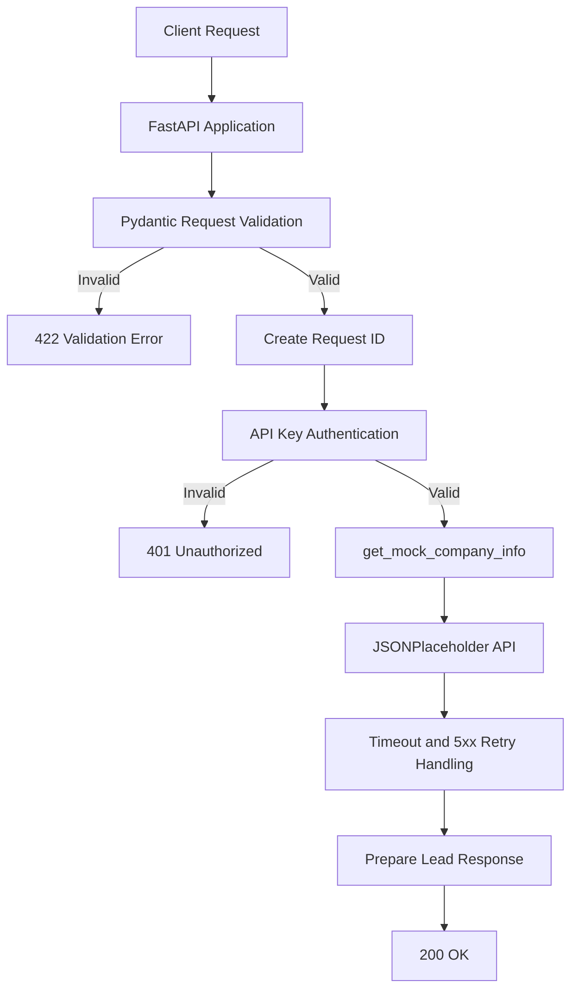
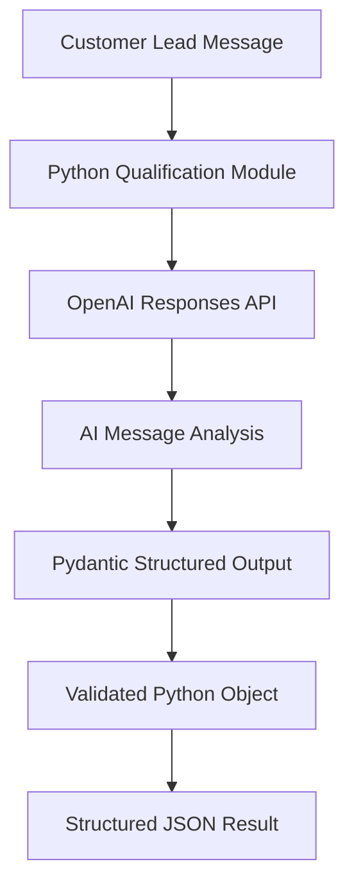

# AI-Enhanced FastAPI Lead Intake & Qualification System

A Python-based backend and AI integration project built with **FastAPI, Pydantic, and OpenAI**.

This project demonstrates secure lead intake through a REST API, automated data validation, API-key authentication, external API communication, retry and error handling, and AI-powered lead qualification using OpenAI Structured Outputs.

The system is being developed through a hands-on, milestone-based approach, with a focus on practical backend engineering and real-world AI automation applications.

**Project Status:** Active Development — Week 4

---

## 1. Project Overview

Businesses receive customer inquiries through websites, contact forms, and other channels. Manually reviewing these inquiries, identifying customer requirements, and determining their urgency can be time-consuming.

This project explores how backend APIs and AI can help streamline the lead management process.

The current implementation consists of two independent components:

**1. FastAPI Lead Intake API**

Receives lead information, validates incoming data, authenticates requests using an API key, retrieves demonstration company information from an external API, and handles upstream failures.

**2. AI-Powered Lead Qualification Module**

Uses OpenAI's Responses API and Pydantic Structured Outputs to analyze customer messages and classify their service requirements, urgency, and human review needs.

The AI qualification module currently runs independently of the FastAPI application. Connecting both components into a unified lead automation workflow is part of the upcoming development roadmap.

---

## 2. Key Features

### FastAPI Lead Intake

- REST API development using FastAPI.
- Incoming lead validation using Pydantic.
- Email validation using `EmailStr`.
- API-key authentication through the `X-API-Key` request header.
- Unique request ID generation using UUID.
- External API integration.
- Request timeout protection.
- Retry handling for upstream HTTP 5xx errors and request timeouts.
- Controlled HTTP error responses.
- Structured application logging.

### AI-Powered Lead Qualification

- OpenAI API integration using the official Python SDK.
- AI-based analysis of customer messages.
- Structured JSON generation using OpenAI Responses API.
- Pydantic-based structured output validation.
- Service interest classification.
- Lead urgency classification.
- AI-generated classification reasoning.
- Human review flag for unclear or insufficient information.

### Testing and Reliability

- Automated testing using Pytest.
- FastAPI endpoint testing.
- Authentication testing.
- Invalid input testing.
- Pydantic schema validation testing.
- Upstream timeout and HTTP 500 retry testing.
- Mock-based testing to avoid unnecessary external API requests.

---

## 3. Technology Stack

| Technology | Purpose |
|---|---|
| Python | Core programming language |
| FastAPI | REST API development |
| Pydantic | Data validation and structured schemas |
| OpenAI Python SDK | AI integration |
| OpenAI Responses API | Structured AI responses |
| python-dotenv | Environment variable management |
| Requests | External HTTP requests |
| Uvicorn | ASGI application server |
| Pytest | Automated testing |
| HTTPX | API testing support |
| Git & GitHub | Version control and project hosting |

---

## 4. System Architecture

The current implementation contains two separate execution paths.

### A. FastAPI Lead Intake Workflow



### B. AI Lead Qualification Workflow



**Architecture Note:** The FastAPI and AI qualification workflows are currently separate. End-to-end integration is planned for a future development milestone.

---

## 5. FastAPI Lead Intake API

The FastAPI application provides two endpoints.

### Health Check

**Endpoint:**

```http
GET /health
```

Purpose:

Checks whether the API application is running.

Example response:

```json
{
  "status": "ok"
}
```

This endpoint does not require API-key authentication.

### Create Lead

**Endpoint:**

```http
POST /leads
```

Required request header:

```text
X-API-Key: your-api-key
```

Example request body:

```json
{
  "event_id": "evt_001",
  "name": "Rahim Ahmed",
  "email": "rahim@example.com",
  "phone": "01700000000",
  "message": "I need help with workflow automation."
}
```

### Lead Data Model

The application uses a Pydantic model named `Lead`.

| Field | Data Type | Requirement |
|---|---|---|
| `event_id` | String | Required |
| `name` | String | Required |
| `email` | EmailStr | Required, valid email |
| `phone` | String or None | Optional |
| `message` | String | Required |

FastAPI automatically validates incoming request bodies using this model.

### Successful Response Example

```json
{
  "status": "received",
  "request_id": "generated-uuid",
  "lead": {
    "event_id": "evt_001",
    "name": "Rahim Ahmed",
    "email": "rahim@example.com",
    "phone": "01700000000",
    "message": "I need help with workflow automation."
  },
  "company_info": {
    "id": 1,
    "name": "Demo Company",
    "email": "demo@example.com",
    "phone": "123456"
  }
}
```

The company information above is illustrative. The actual values are retrieved from the external demonstration API.

---

## 6. Authentication and Request Validation

The `/leads` endpoint uses API-key authentication through the `X-API-Key` header.

The request processing sequence is:

1. FastAPI receives the request.
2. Pydantic validates the incoming request body.
3. The application generates a unique request ID.
4. The supplied API key is compared with the configured server API key.
5. Unauthorized requests are rejected.
6. Authenticated requests proceed to external API communication.
7. The application prepares and returns the final response.

### Authentication Behavior

- Missing API key: HTTP 401.
- Incorrect API key: HTTP 401.
- Valid API key: Request processing continues.

**Note:** FastAPI request validation happens before the endpoint function executes. Therefore, an invalid request body can return HTTP 422 before API-key authentication is evaluated.

---

## 7. External API Integration and Retry Handling

The application retrieves demonstration company information from the JSONPlaceholder API.

**External API endpoint:**

```text
https://jsonplaceholder.typicode.com/users/1
```

The current implementation uses:

| Configuration | Value |
|---|---|
| Request method | GET |
| Request timeout | 5 seconds |
| Maximum attempts | 3 |
| Retry on timeout | Yes |
| Retry on HTTP 5xx | Yes |
| Retry on other request errors | No |

### Retry Behavior

**Upstream HTTP 5xx errors**

The application retries the request up to three total attempts. If all attempts fail, it returns HTTP 502.

**Request Timeout**

The application retries up to three total attempts. If all attempts time out, it returns HTTP 504.

**Other Request Exceptions**

Other Requests library exceptions are logged and handled with HTTP 502 without additional retries.

**Important:** The current retry implementation does not include exponential backoff or delay between attempts.

The external API is used for demonstration purposes. It always requests a predefined demo user and does not perform real company enrichment based on the submitted lead information.

---

## 8. Error Handling

The application returns controlled HTTP responses for common failure scenarios.

| Scenario | HTTP Status | Description |
|---|---:|---|
| Successful health check | 200 | API is running |
| Successful lead submission | 200 | Lead accepted |
| Missing or invalid API key | 401 | Authentication failed |
| Invalid request body | 422 | Pydantic validation failed |
| Upstream service failure | 502 | External request failed |
| Upstream timeout after retries | 504 | External service did not respond |

The application also records relevant events through Python's logging module.

---

## 9. AI-Powered Lead Qualification

The AI module analyzes customer messages and returns structured lead qualification data.

It uses:

- OpenAI's official Python SDK.
- OpenAI Responses API.
- `client.responses.parse()`.
- Pydantic Structured Outputs.
- A custom `LeadQualification` model.

### Lead Qualification Schema

The Pydantic model defines four required fields.

| Field | Type | Purpose |
|---|---|---|
| `service_interest` | Literal | Identifies the requested service |
| `urgency` | Literal | Classifies lead urgency |
| `reason` | String | Explains the classification |
| `needs_review` | Boolean | Indicates whether human review is needed |

### Allowed Service Categories

- `marketing_automation`
- `crm_integration`
- `lead_generation`
- `other`

### Allowed Urgency Levels

- `low`
- `medium`
- `high`

The schema uses `ConfigDict(extra="forbid")` to reject additional fields that are not part of the defined qualification structure.

### Example Input

```text
I run a marketing agency and need an AI
automation system to manage my leads.

This is urgent because we are receiving
too many customer inquiries.
```

### Example AI Output

```json
{
  "service_interest": "marketing_automation",
  "urgency": "high",
  "reason": "The lead needs an AI automation system to manage leads and explicitly describes the requirement as urgent.",
  "needs_review": false
}
```

### Human Review Support

The `needs_review` field allows the AI module to flag unclear or insufficient lead messages for potential human review.

It is currently a classification flag, not a fully implemented human approval workflow.

**Important:** Structured Outputs enforce the response format and schema, but do not guarantee that every AI-generated classification is factually correct. Additional evaluation and human oversight are necessary for reliable business use.

---

## 10. Project Structure

```text
API/
│
├── main.py
│   └── Main FastAPI application
│
├── test_main.py
│   └── FastAPI endpoint and integration tests
│
├── lead_schemas.py
│   └── Pydantic AI qualification schema
│
├── qualify_lead.py
│   └── OpenAI-powered lead qualification module
│
├── check_openai_connection.py
│   └── OpenAI API connection verification
│
├── test_lead_schemas.py
│   └── Pydantic schema validation tests
│
├── requirements.txt
│   └── Project dependencies
│
├── .env.example
│   └── Environment variable template
│
├── .gitignore
│   └── Git exclusion rules
│
└── README.md
    └── Project documentation
```

The actual `.env` file and `.venv` directory are maintained locally and excluded from version control.

Personal learning diagrams and flowcharts are also maintained locally and are not included in the public repository.

---

## 11. Environment Variables and Security

The project uses environment variables to manage sensitive configuration values.

Create a local `.env` file in the project root.

Example:

```env
API_KEY=your-secret-api-key
OPENAI_API_KEY=your-openai-api-key
```

### Environment Variable Usage

| Variable | Used By | Purpose |
|---|---|---|
| `API_KEY` | FastAPI application | Lead endpoint authentication |
| `OPENAI_API_KEY` | OpenAI integration scripts | OpenAI API authentication |

### Security Practices

- Never commit the actual `.env` file.
- Never hardcode OpenAI API keys in source code.
- Never expose API credentials in public repositories.
- Use `.env.example` with placeholder values.
- Keep the `.venv` directory excluded from Git.
- Store API credentials securely.

The current API-key authentication is a basic shared-secret implementation. Production deployment will require additional security measures such as HTTPS, credential rotation, rate limiting, and more robust access controls.

---

## 12. Installation and Setup

### Prerequisites

- Python installed.
- Git installed.
- An OpenAI API account for live AI functionality.
- An active OpenAI API key with sufficient API credit.

### Step 1: Clone the Repository

```bash
git clone https://github.com/Hadicse2007/fastapi-lead-intake-api.git
```

Navigate to the project directory:

```bash
cd fastapi-lead-intake-api
```

### Step 2: Create a Virtual Environment

```bash
python -m venv .venv
```

### Step 3: Install Dependencies

**Windows PowerShell:**

```powershell
.\.venv\Scripts\python.exe -m pip install -r requirements.txt
```

**macOS/Linux:**

```bash
source .venv/bin/activate
python -m pip install -r requirements.txt
```

### Step 4: Configure Environment Variables

Copy `.env.example` to `.env`.

**Windows PowerShell:**

```powershell
Copy-Item .env.example .env
```

**macOS/Linux:**

```bash
cp .env.example .env
```

Update the placeholder values with your own credentials.

Never upload the actual `.env` file to GitHub.

---

## 13. Running the Application

### Start the FastAPI Server

**Windows PowerShell:**

```powershell
.\.venv\Scripts\python.exe -m uvicorn main:app --reload
```

**macOS/Linux:**

```bash
python -m uvicorn main:app --reload
```

The API will be available at:

```text
http://127.0.0.1:8000
```

Interactive API documentation:

```text
http://127.0.0.1:8000/docs
```

### Verify OpenAI API Connection

```powershell
.\.venv\Scripts\python.exe check_openai_connection.py
```

This script sends a small live API request to verify OpenAI connectivity.

### Run AI Lead Qualification

```powershell
.\.venv\Scripts\python.exe qualify_lead.py
```

The current qualification script uses a sample lead message and prints the AI-generated structured result.

The AI integration uses the OpenAI model configured in the script.

Live OpenAI requests require a valid API key and may incur API usage charges.

---

## 14. Automated Testing

The project uses Pytest to verify API functionality and Pydantic validation behavior.

### Run All Tests

**Windows PowerShell:**

```powershell
.\.venv\Scripts\python.exe -m pytest -v
```

### FastAPI Tests — `test_main.py`

The FastAPI test suite covers eight scenarios:

1. Health check.
2. Valid lead submission.
3. Missing required message.
4. Invalid email.
5. Missing API key.
6. Incorrect API key.
7. Upstream timeout after retries.
8. Upstream HTTP 500 after retries.

External API requests are mocked in relevant tests to avoid unnecessary network dependencies.

### Pydantic Tests — `test_lead_schemas.py`

The schema test suite covers five scenarios:

1. Valid lead qualification data.
2. Invalid service interest.
3. Invalid urgency.
4. Missing required field.
5. Rejection of additional fields.

### Latest Development Test Results

| Test Suite | Passed | Failed |
|---|---:|---:|
| FastAPI tests | 8 | 0 |
| Pydantic schema tests | 5 | 0 |
| **Total** | **13** | **0** |

**Latest verified result: 13 tests passed.**

The automated test suite runs locally without requiring live OpenAI API requests.

---

## 15. Current Development Scope and Limitations

This project is under active development.

The following capabilities are not yet implemented:

- Database persistence.
- Duplicate event protection and idempotency.
- AI qualification integrated into the FastAPI `/leads` endpoint.
- A dedicated AI qualification endpoint.
- CRM integration.
- n8n workflow integration.
- Actual human approval and review interface.
- Production deployment.
- CI/CD automation.
- Production-level monitoring.
- Advanced retry strategies with exponential backoff.

The AI qualification module currently operates independently of the FastAPI application.

The external company information lookup uses a predefined JSONPlaceholder demo endpoint rather than a real company enrichment service.

---

## 16. Future Development Roadmap

### Phase 1 — Advanced AI Lead Qualification

- Test multiple lead messages.
- Improve classification rules.
- Evaluate low, medium, and high-intent leads.
- Improve handling of unclear messages.
- Implement human review conditions.
- Add robust AI error handling.

### Phase 2 — FastAPI and AI Integration

- Connect AI qualification to the lead intake endpoint.
- Create dedicated qualification endpoints.
- Return consistent structured API responses.
- Add automated integration tests.

### Phase 3 — Workflow Automation

- Integrate n8n.
- Automate incoming lead processing.
- Add email notifications.
- Connect CRM systems.
- Build end-to-end automation workflows.

### Phase 4 — Data Management

- Add database persistence.
- Implement duplicate event protection.
- Maintain lead processing status.
- Add reliable retry and recovery mechanisms.

### Phase 5 — Portfolio and Deployment

- Create professional architecture diagrams.
- Add real project screenshots and demonstrations.
- Improve documentation.
- Deploy the application.
- Add CI/CD and production monitoring.

---

## 17. Project Objective

The long-term objective is to develop a reliable, extensible, and portfolio-ready AI Lead Management and Qualification System.

The project focuses on practical capabilities in:

- Backend API development.
- Python application engineering.
- Data validation.
- API authentication.
- External API integration.
- AI model integration.
- Structured AI outputs.
- Workflow automation.
- Automated testing.
- Professional software documentation.

The development process emphasizes hands-on implementation, practical problem-solving, and building solutions that can eventually be demonstrated in real-world freelancing and client projects.

**Developer Note:** This project is continuously evolving as part of an AI Automation Engineering and Backend Development learning roadmap.